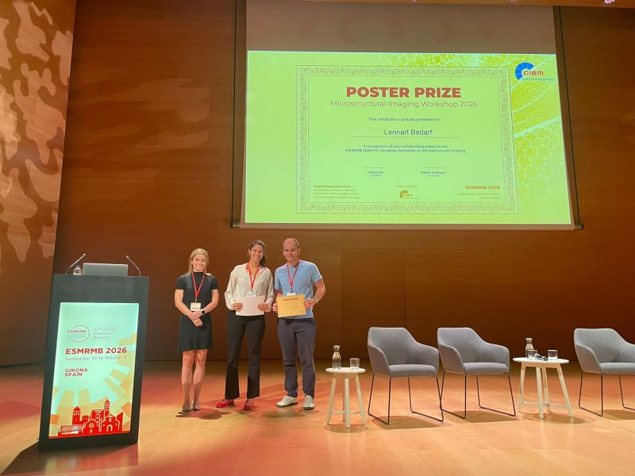

<strong>Bedarf, L.</strong>, Neuhaus D., Scheurer E., Lenz C. (2026).
<em>Incomplete reversibility of fixation-induced changes in postmortem 
human brain white matter MRI following rehydration</em>

{width=80% fig-align="center"}

